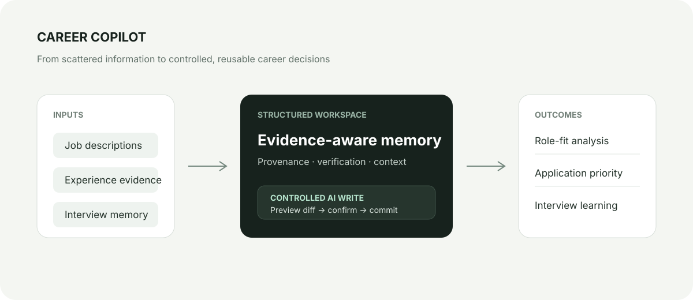

# Career Copilot

> A privacy-first AI career workspace that turns fragmented job-search information into a reusable decision system.

Career Copilot is a personal product project designed for internship and early-career job seekers. It brings job descriptions, experience evidence, interview questions, capability gaps, and application decisions into one structured workspace—then lets an AI assistant reason over that information without inventing facts or silently changing records.

This repository is a **sanitized product showcase**. The production repository and personal job-search data remain private.



## The problem

Most job-search workflows are scattered across browser favorites, screenshots, spreadsheets, chat histories, and memory. This creates three recurring problems:

- candidates repeatedly analyze the same role from scratch;
- interview experience disappears instead of becoming reusable evidence;
- general-purpose AI assistants can produce confident answers without knowing which facts are verified.

Career Copilot treats a job search as a growing personal knowledge system rather than a collection of one-off conversations.

## Product principles

1. **Evidence before advice** — verified experience is separated from assumptions and future plans.
2. **Preview before write** — AI-generated changes are shown as a complete diff and require explicit confirmation.
3. **Private by default** — personal records stay in a private database; the public repository contains no real resumes, JDs, interview records, tokens, or credentials.
4. **Memory that compounds** — every role, interview, and reflection can improve future decisions.

## Core workflows

- **JD library:** archive, search, filter, and compare full job descriptions with their source and collection date.
- **Role analysis:** extract capabilities from a JD and compare them with verified experience evidence.
- **Experience bank:** maintain reusable stories for resumes and behavioral interviews, with verification status.
- **Interview memory:** connect original questions and follow-ups to a real interview session instead of storing decontextualized question lists.
- **Application prioritization:** rank opportunities by fit, learning value, strategic relevance, and application cost.
- **Controlled AI updates:** prepare a proposed change, review the diff, and commit only after explicit approval.

## System design

```text
Browser workspace / AI assistant
              │
              ▼
      FastAPI service layer
       ├─ read tools
       ├─ controlled write tools
       ├─ audit and validation
       └─ backup and restore
              │
              ▼
 SQLite (local) / PostgreSQL (cloud)
```

The working product uses a FastAPI and SQLAlchemy backend, a lightweight dependency-free web interface, SQLite for local use, and PostgreSQL for private cloud deployment. An MCP-compatible interface allows an AI assistant to query structured records and propose controlled updates.

More detail: [Architecture](docs/architecture.md) · [Product case study](docs/case-study.md)

## What I worked on

I defined the product problem, information architecture, safety boundaries, interaction rules, and acceptance scenarios. I also iterated on the implementation with AI coding tools and validated the resulting workflows through automated tests and real personal use.

My focus was not simply “adding AI.” It was deciding **where AI should reason, where the database should remain authoritative, and where the user must stay in control**.

## Current status

- Private single-user web workspace implemented
- Structured JD, experience, interview, and assessment records implemented
- Read and controlled-write AI tools implemented
- Backup, restore, audit, and automated test coverage implemented
- Multi-platform job collection workflow under active iteration

## Privacy note

The original project contains private career information and is intentionally not public. All examples in this showcase are abstracted or synthetic. This repository documents the product and engineering decisions without publishing user data or production credentials.

## Contact

Alan Wang · [philwang12138@gmail.com](mailto:philwang12138@gmail.com)

